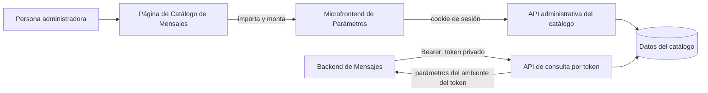
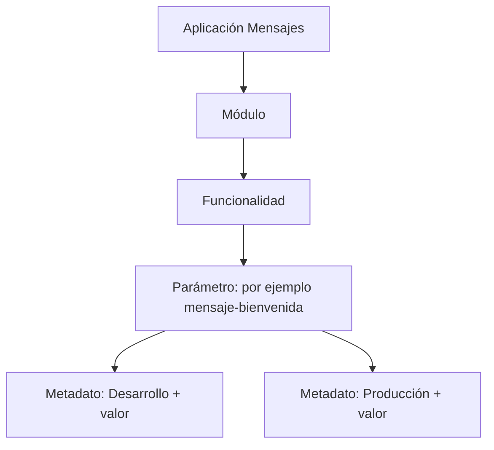

# Guía para integrar el microfrontend de Parámetros en Catálogo de Mensajes

Esta guía está dirigida al equipo de Catálogo de Mensajes. Explica cómo insertar la pantalla de administración de parámetros y cómo hacer que el backend de Mensajes consulte los valores guardados.

## 1. La idea general

Hay dos integraciones distintas:

| Parte | Para qué sirve | Quién la ejecuta | Credencial |
| --- | --- | --- | --- |
| Microfrontend | Crear y administrar módulos, funcionalidades, parámetros y valores por ambiente | Navegador de la persona usuaria | Sesión iniciada en Seguridad |
| API de consulta | Leer parámetros desde la lógica de Mensajes | Backend de Catálogo de Mensajes | Token de consulta del Catálogo de Parámetros |

El microfrontend no contiene el secreto de consulta y no reemplaza la llamada del backend. El backend tampoco necesita abrir el microfrontend para leer datos.



## 2. Qué deben solicitar al equipo del catálogo

Antes de integrar, acuerden estos datos con quien administra el Catálogo de Parámetros:

1. **UUID de la aplicación** de Catálogo de Mensajes dentro del Catálogo de Parámetros.
2. **URL del archivo ESM** `parametros-administration.js` o el paquete completo para alojarlo ustedes.
3. **URL base del API** que termina en `/catalogo-parametros/api/v1`.
4. **URL de consulta de red** que pueda alcanzar el backend de Mensajes (puede diferir de la URL del navegador).
5. Persona administradora que configure en Seguridad la sesión y los permisos necesarios.

El `applicationId` es el UUID de la aplicación del catálogo. No es el ID de aplicación registrado en Seguridad, ni el ID del token.

## 3. Preparar la aplicación y los parámetros

En la consola del Catálogo de Parámetros, creen o seleccionen la aplicación de Mensajes. Dentro de ella, organicen los datos así:



Pasos:

1. Crear o seleccionar un **módulo**.
2. Crear una **funcionalidad** dentro del módulo.
3. Crear un **parámetro** dentro de la funcionalidad y elegir su tipo.
4. Crear un **metadato** para ese parámetro: elegir tipo de metadato, ambiente y valor.
5. Repetir el metadato para cada ambiente que necesite un valor distinto.

El valor se escribe como JSON. Ejemplos: texto: `"Bienvenido"`; número: `3`; objeto: `{"titulo":"Bienvenido"}`. El ambiente del metadato es obligatorio. La asociación de estado por ambiente es una configuración administrativa adicional; no sustituye el ambiente elegido en el metadato.

## 4. Insertar el microfrontend en la pantalla de Mensajes

El paquete es un ESM autónomo. No requiere que el host use Angular y no utiliza un `iframe`. Se monta dentro de un elemento HTML y encapsula sus estilos.

### HTML

```html
<section>
  <h2>Administrar parámetros de Mensajes</h2>
  <div id="parametros-mensajes"></div>
</section>
```

### JavaScript

```html
<script type="module">
  import { mount } from 'https://URL-DEL-CATALOGO/parametros-ui/parametros-administration.js';

  const container = document.querySelector('#parametros-mensajes');

  const parametrosUi = mount(container, {
    applicationId: 'UUID-DE-LA-APLICACION-DE-MENSAJES',
    apiBaseUrl: 'https://API-DEL-CATALOGO/catalogo-parametros/api/v1',

    // Conectar con el flujo de autenticación que ya use el host.
    onAuthenticationRequired: () => {
      window.location.assign('/iniciar-sesion');
    },

    // Opcional: enterarse de cambios guardados en el catálogo.
    onChange: (event) => {
      console.info('Cambio en parámetros', event.resource, event.operation);
    }
  });

  await parametrosUi.ready;

  // Al cerrar/destruir la pantalla:
  // parametrosUi.unmount();
</script>
```

Cambien las URL y el UUID de ejemplo por los valores entregados para su entorno. El callback `onAuthenticationRequired` debe iniciar el login de Mensajes/Seguridad. No basta con dejar el ejemplo si el host utiliza otra ruta para autenticarse.

Si el host es Angular, React o Vue, el mismo patrón aplica: llamar `mount(...)` cuando exista el elemento y `handle.unmount()` al destruir la vista. `await handle.ready` permite esperar la carga inicial; `handle.refresh()` pide una recarga manual.

## 5. Sesión, permisos y el error de destino de retorno

El widget envía las peticiones administrativas con la cookie de sesión del navegador. No inicia la sesión por su cuenta. El usuario necesita permisos de lectura y escritura concedidos por el administrador de Seguridad para los recursos administrativos del Catálogo de Parámetros y la aplicación de Mensajes.

El origen de la página de Mensajes también debe estar configurado donde corresponda:

- Como origen permitido para llamadas con credenciales al API (`FRONTEND_ALLOWED_ORIGINS` en el despliegue del catálogo).
- Como destino de retorno permitido en el BFF de Seguridad para completar el login.
- En la política CSP del host, si existe: permitir el origen del módulo en `script-src` y el API/SSE en `connect-src`.

Estos ajustes son independientes. CORS no autoriza el retorno del login ni concede permisos de API.

Si aparece `"El destino de retorno no está autorizado"` en `/oauth2/authorization/keycloak`, Seguridad está rechazando la URL a la que el host quiere regresar tras autenticarse. El equipo que administra el BFF debe permitir el origen exacto desde el que se abre Mensajes, incluyendo esquema, dominio y puerto. Por ejemplo, `http://localhost:4300` y `http://127.0.0.1:4300` son direcciones distintas para esta configuración. Después se debe iniciar el login desde la URL permitida.

Un `401` significa que falta una sesión válida; el widget llama a `onAuthenticationRequired`. Un `403` normalmente indica que hay sesión, pero al usuario le faltan permisos. Un `404` al guardar puede indicar que el registro o su padre pertenece a otra aplicación.

## 6. Crear y editar desde el microfrontend

Cuando el widget carga, consulta los datos de la aplicación indicada por `applicationId`. La persona puede cambiar entre las secciones de módulos, funcionalidades, parámetros, metadatos y asociaciones por ambiente. Los selectores de ambiente, tipos y estados se alimentan desde el catálogo; el widget no crea catálogos globales.

Para agregar un valor utilizable por Mensajes:

1. Completar la jerarquía módulo → funcionalidad → parámetro si aún no existe.
2. Abrir **Metadatos** y crear el valor asociado al parámetro.
3. Elegir el ambiente correcto y guardar un JSON válido.
4. Verificar que el parámetro y sus elementos superiores estén activos y dentro de vigencia.

El widget actualiza los datos al guardar y escucha cambios del catálogo mediante SSE. También hace un refresco periódico mientras está visible. Al salir de la pantalla, el host debe llamar `unmount()` para liberar la conexión y los temporizadores.

## 7. Dar acceso de administración

El administrador de Seguridad debe asignar al usuario recursos de administración del Catálogo de Parámetros bajo la aplicación de Mensajes. Se requiere lectura del catálogo y de eventos, además de los métodos de escritura necesarios para módulos, funcionalidades, parámetros, metadatos y metadatos-ambiente.

La base de las rutas es:

```text
/catalogo-parametros/api/v1/aplicaciones/{UUID_APLICACION}/administracion
```

El widget usa `GET` sobre esa base y `/events`; usa `POST`, `PUT` y `DELETE` en las subrutas `modulos`, `funcionalidades`, `parametros`, `metadatos` y `metadatos-ambiente`. La concesión debe incluir los recursos y métodos específicos que el rol necesita. Registrar una ruta sin asignarla a un rol/perfil del usuario no otorga acceso.

## 8. Configurar la consulta en el backend de Mensajes

La consulta de runtime se hace entre servidores. En la consola central del Catálogo de Parámetros, creen un token para la aplicación de Mensajes y el ambiente correspondiente. Guarden el **ID del token** y su **secreto** en un gestor de secretos o variables privadas del backend consumidor. El secreto se muestra al crearlo y el catálogo guarda su hash; si se pierde, hay que emitir otro.

El token vincula la aplicación y el ambiente. Para cambiar de ambiente, se usa un token creado para ese ambiente. No pongan el secreto en el frontend ni lo envíen en `mount(...)`.

El backend de Mensajes llama:

```http
GET {BASE_API}/tokens/{ID_DEL_TOKEN}/parametros
Accept: application/json
Authorization: Bearer {SECRETO_DEL_TOKEN}
```

Donde `BASE_API` termina en `/catalogo-parametros/api/v1`. Ejemplo local cuando el backend puede alcanzar ese host:

```text
GET http://localhost:8080/catalogo-parametros/api/v1/tokens/UUID-TOKEN/parametros
```

Si Mensajes corre en un contenedor, `localhost` se refiere al propio contenedor. Usen el hostname del servicio del catálogo en la misma red Docker o la dirección interna del despliegue.

La respuesta incluye `aplicacion`, `ambiente` y `parametros`. Cada parámetro trae su definición, funcionalidad, módulo, metadatos y configuración de ambiente. El valor está en:

```text
parametros[i].metadatos[j].metadato.valor
```

El servidor filtra según la aplicación y ambiente del token y la disponibilidad de los registros. Si un valor no aparece, verifiquen el ambiente del metadato, el token usado y que los registros de la jerarquía estén disponibles. No se debe buscar un valor sustituto en otro ambiente.

## 9. Ensayo local con el host de demostración

En el workspace hay un host de prueba Vue ya preparado en [MicrofrontendParametrosDemo](../../../MicrofrontendParametrosDemo/README.md). Permite montar el mismo paquete que integraría Mensajes.

### Antes de empezar

El ensayo necesita que estén levantados:

- Frontend proveedor del catálogo en `http://localhost:4200` (publica el ESM).
- API del catálogo en `http://localhost:8080`.
- Seguridad/PEP, con sesión válida y permisos administrativos para la aplicación que probarán.

El `docker-compose.yml` de este proyecto ya incluye `http://localhost:4300` entre los orígenes CORS. Seguridad también debe permitir `http://localhost:4300` como destino de retorno del login. Si aparece el error de retorno no autorizado, el ensayo no llegará a montar el widget hasta corregir ese permiso en el BFF.

### Ejecutar el host

En una terminal:

```sh
cd ../../MicrofrontendParametrosDemo
npm ci
npm run dev
```

Abrir `http://localhost:4300`. Ingresar el UUID de la aplicación de Mensajes en el Catálogo de Parámetros y pulsar **Montar microfront**. La aplicación debe cargar el ESM desde el puerto 4200 y consultar el API del puerto 8080.

### Comprobar que permite crear

Con una sesión y permisos adecuados:

1. Crear un módulo, una funcionalidad y un parámetro de prueba.
2. Crear un metadato para el parámetro con el ambiente de prueba y un valor, por ejemplo `"ensayo-mensajes"`.
3. Confirmar que el registro aparece en la lista y que el host muestra el evento de cambio.

Si no hay permisos, el widget puede cargar la aplicación pero las operaciones responderán `403`. Si no hay sesión, el host debe iniciar el login; el retorno debe estar permitido para `http://localhost:4300`.

### Comprobar que el backend puede leerlo

En la consola central del catálogo, crear un token para la misma aplicación y el mismo ambiente usado en el metadato. Copiar el ID y secreto al entorno privado del backend de Mensajes. Desde una terminal con conectividad al API, ejecutar:

```sh
curl -H 'Accept: application/json' \
     -H 'Authorization: Bearer SECRETO_DEL_TOKEN' \
     'http://localhost:8080/catalogo-parametros/api/v1/tokens/ID_DEL_TOKEN/parametros'
```

La respuesta debe incluir el parámetro y el valor `ensayo-mensajes` en `parametros[].metadatos[].metadato.valor`. No compartan el secreto ni lo peguen en el código frontend. Si prueban otro ambiente, creen un token para ese ambiente y su propio metadato de prueba.

Para detener el host, usar `Ctrl+C` en la terminal. El host de demostración no levanta por sí solo el catálogo, el API ni Seguridad.

## 10. Prueba de punta a punta

1. Abrir la pantalla de Mensajes con la URL que Seguridad tiene permitida.
2. Iniciar sesión y confirmar que el microfrontend carga sin errores.
3. Crear un parámetro de prueba y un metadato para el ambiente de prueba.
4. Confirmar que el valor aparece en la lista del widget.
5. Desde el backend de Mensajes, llamar al endpoint con el ID y secreto del token de ese ambiente.
6. Confirmar que la respuesta contiene el parámetro y su valor esperado.
7. Probar con un token de otro ambiente y confirmar que devuelve el valor correspondiente a ese ambiente, no el anterior.
8. Salir de la pantalla y comprobar que el host desmonta el widget.

## 11. Diagnóstico rápido

| Síntoma | Revisar |
| --- | --- |
| `El destino de retorno no está autorizado` | URL exacta de Mensajes permitida en el BFF de Seguridad como retorno del login |
| El módulo JavaScript no carga | URL/archivo ESM, acceso al host del paquete y CSP `script-src` |
| `401` al abrir o usar el widget | Sesión/cookie del navegador y callback `onAuthenticationRequired` |
| `403` al listar o guardar | Permisos del usuario en Seguridad para aplicación, método y ruta |
| Falla CORS | Origen exacto de Mensajes en `FRONTEND_ALLOWED_ORIGINS`, credenciales/cookies y protocolo |
| `401` al consultar desde backend | Secreto Bearer, ID del token, estado activo y vencimiento |
| La consulta responde sin parámetros/valor | Aplicación y ambiente del token, ambiente del metadato y vigencia/estado de la jerarquía |
| Funciona localmente, falla entre contenedores | URL de red: dentro de Docker, `localhost` apunta al contenedor llamante |

## Referencias del proyecto

- [Guía de adopción del catálogo](guia-adopcion-parametros.md)
- [Administración embebida y consulta](microfrontend-parametros.md)
- [Integración con Seguridad](SEGURIDAD-INTEGRACION.md)
- [Contrato OpenAPI de administración](openapi/catalogo-administracion-v1.yaml)
